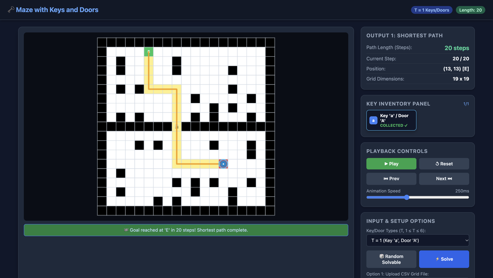
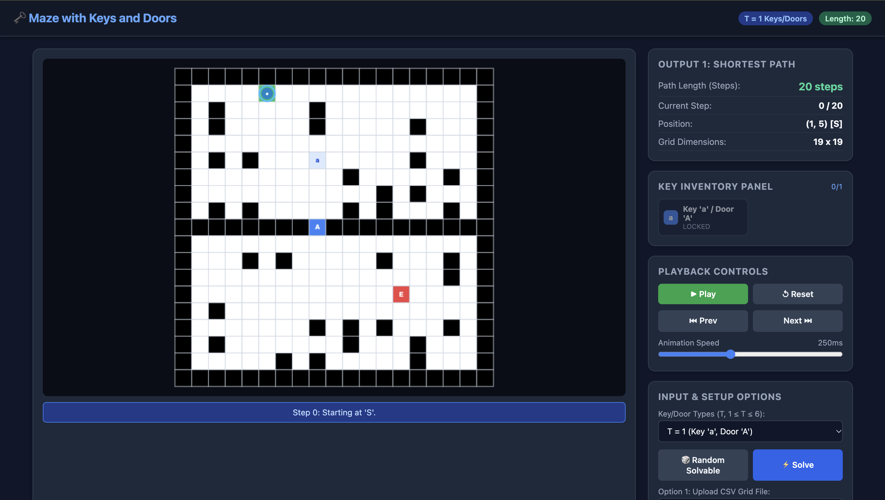
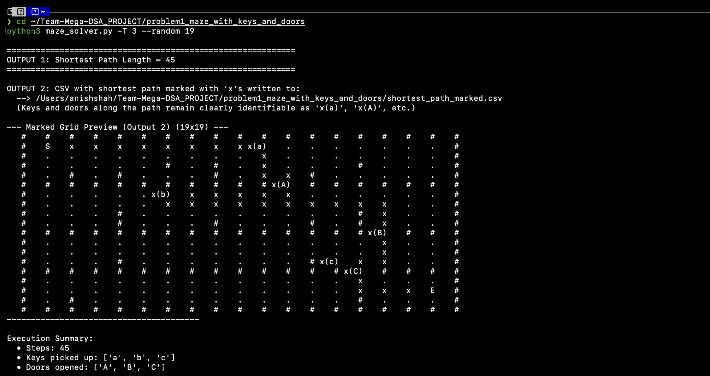

# Problem 1: Maze with Keys and Doors

A complete, high-performance solution with full BFS state-space exploration, guaranteed solvable random maze generation, strict Output 1 & Output 2 formatting, and dual visualizers (Desktop Tkinter GUI + Interactive HTML5 Canvas).

---

## 📌 Problem Overview

Given an $N \times N$ grid where each cell is:
- `.` : Open cell
- `#` : Wall
- `S` : Start position
- `E` : Exit position
- `'a'` – `'f'` : Key (automatically collected upon stepping on it; keys are reusable)
- `'A'` – `'F'` : Door (can only be entered if holding the matching key)

Find the length of the shortest path from `S` to `E`.

---

## 📥 Input Format

- **Standard input line**: `T` (number of distinct key/door types, $1 \le T \le 6$)
- **Option 1**: Read the $N \times N$ grid from a CSV file.
- **Option 2**: Generate the $N \times N$ grid randomly to form a valid maze containing $T$ keys and $T$ doors, with at least one solvable path.

---

## 📤 Output Format

- **Output 1**: Single integer shortest path length, or `-1` if not possible.
- **Output 2**: A CSV file with the shortest path marked with `'x'`s (keys picked up and doors opened along the path remain clearly identifiable, e.g. `x(a)`, `x(A)`).

---

## 🎨 Visualization Specifications

- **Grid Colors**:
  - **White (`#FFFFFF`)**: Open cell (`.`)
  - **Black (`#000000`)**: Wall (`#`)
  - **Green (`#4CAF50`)**: Start (`S`)
  - **Red (`#F44336`)**: Exit (`E`)
  - **Unique Color per Key/Door pair**:
    - **Pair 1 (`a` / `A`)**: Blue (`#1E88E5`)
    - **Pair 2 (`b` / `B`)**: Orange (`#FB8C00`)
    - **Pair 3 (`c` / `C`)**: Purple (`#8E24AA`)
    - **Pair 4 (`d` / `D`)**: Gold (`#FDD835`)
    - **Pair 5 (`e` / `E`)**: Cyan (`#00ACC1`)
    - **Pair 6 (`f` / `F`)**: Pink (`#E91E63`)
- **Path Highlight**: Visited path cells are illuminated with an amber path trail.
- **Animations**:
  - **Key pick-up**: Key disappears from the cell, and the **Key-Inventory Panel** updates in real-time to show `COLLECTED ✓`.
  - **Door opening**: Door cell turns from its color to **white** with an unlock mark (`🔓`).

---

## 📸 Output & Visualizer Screenshots

### 1. Interactive Web Visualizer — Solved Traversal with Key Inventory & Door Unlocks


### 2. Interactive Web Visualizer — Grid Setup & Controls


### 3. Terminal Execution Output — Output 1 & Output 2 Marked Grid Preview


---

## 🚀 Quick Start & How to Run

### 1. Interactive Mode (Standard CLI)
Run without arguments to interactively enter $T$ and select Option 1 or Option 2:
```bash
python3 maze_solver.py
```

### 2. Option 1: Solve from CSV File
```bash
python3 maze_solver.py -T 3 --csv sample_mazes/maze_t3_complex.csv --out output_t3.csv
```

### 3. Option 2: Random Solvable Maze Generation
Generate a guaranteed solvable $15 \times 15$ maze with $T=3$ keys and doors:
```bash
python3 maze_solver.py -T 3 --random 15 --out output_random.csv
```

### 4. Automated Grading Mode (Quiet Single Integer Output 1)
```bash
python3 maze_solver.py -T 1 --csv sample_mazes/maze_t1_simple.csv --quiet
# Outputs: 13
```

### 5. Launch Visualizer
- **Interactive Web Visualizer** (HTML5 Canvas in browser):
  ```bash
  python3 maze_solver.py -T 3 --csv sample_mazes/maze_t3_complex.csv --web
  ```
  *(Or directly: `open visualizer.html`)*

---

## 🧪 Running Automated Tests
Run the complete test suite verifying all $T \in [1, 6]$, Output 1, Output 2, and edge cases:
```bash
python3 test_suite.py
```

---

## 📁 Project Structure

```
maze_solver/
├── maze_solver.py         # Main CLI runner compliant with problem I/O specifications
├── core_solver.py         # Bitmask BFS shortest path solver, CSV I/O, & random generator
├── visualizer_tk.py       # Desktop Tkinter animated visualizer
├── visualizer.html        # Interactive browser-based visualizer with HUD & animations
├── test_suite.py          # Automated verification test suite
├── README.md              # Documentation
└── sample_mazes/          # Sample CSV test files
    ├── maze_t1_simple.csv
    ├── maze_t2_multi_room.csv
    ├── maze_t3_complex.csv
    └── maze_unsolvable.csv
```
